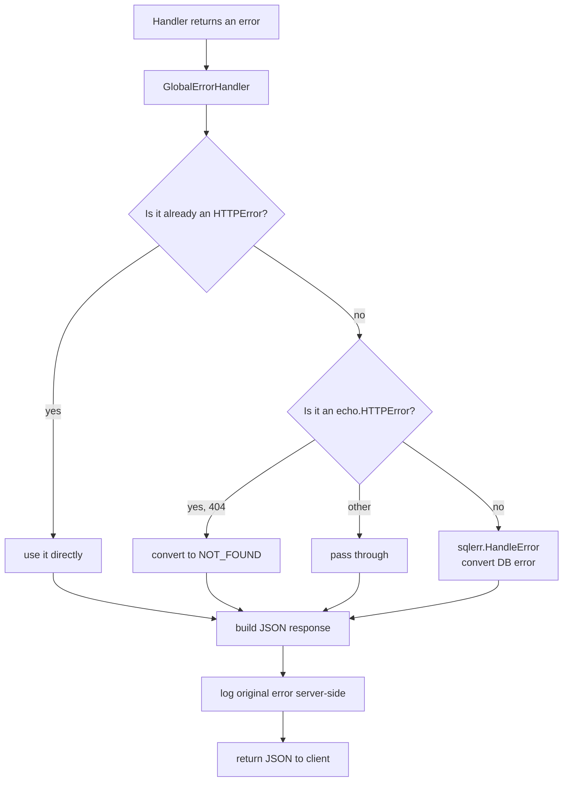
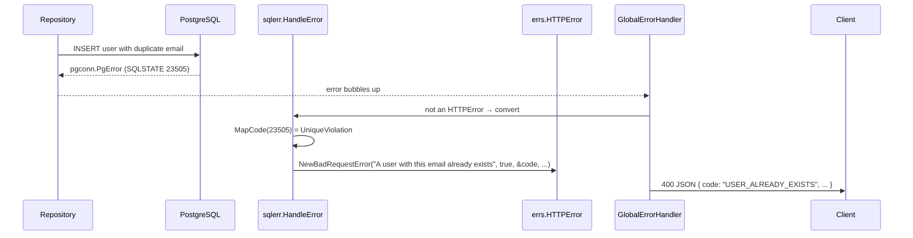

# Errors Package — Explained for Beginners

This file explains **everything** about the `errs` package: the concepts first, then the code, then how it connects to the rest of the backend.

> **Read order:** Concepts → `types.go` → `http.go` → "How it connects"

---

## Part 1 — The Big Idea (read this first)

### What is an "errors package" in a backend?

When something goes wrong in your app, you need to tell the client **what** went wrong — in a consistent, machine-readable way. If every handler returned a different error shape, frontend developers would go crazy trying to parse them.

This package defines **one standard error type** (`HTTPError`) that every error in the app is converted into. It also provides **helper constructors** so you never hand-write an error struct.

### The mental model

```
any error in the app (validation, DB, auth, not-found...)
        │
        │  (converted into)
        ▼
errs.HTTPError  ──►  JSON response to the client
        │
        ├── code      "USER_ALREADY_EXISTS"
        ├── message   "A user with this email already exists"
        ├── status    400
        ├── errors    [ { field: "email", error: "is required" } ]
        └── action    { type: "redirect", ... }
```

### Why a standard error type? (the 3 reasons)

1. **Consistency** — every error response has the same shape, so clients can rely on it.
2. **Machine-readability** — the `code` field lets frontends branch on *what* happened, not parse text.
3. **Safety** — internal details (SQL errors, stack traces) never leak to the client.

### The two files

- **`types.go`** — the *shapes*: `HTTPError`, `FieldError`, `Action`, and a helper.
- **`http.go`** — the *factories*: functions that build ready-made `HTTPError`s for common cases (401, 403, 400, 404, 500).

---

## Part 2 — Go Concepts You MUST Know First

These are the building blocks used everywhere in this file. If you understand these, the code becomes obvious.

### 1. Structs with JSON tags

```go
type FieldError struct {
	Field string `json:"field"`
	Error string `json:"error"`
}
```

The backtick part `` `json:"field"` `` is a **tag** — metadata that tells Go's JSON encoder/decoder what key to use. So `Field` becomes `"field"` in the JSON output. This is how the struct maps to the API contract.

### 2. String-based types (type aliases with meaning)

```go
type ActionType string

const (
	ActionTypeRedirect ActionType = "redirect"
)
```

`ActionType` is a `string` underneath, but making it its own type means you can only assign valid values (like `ActionTypeRedirect`). It's a way to add **type safety** to plain strings.

### 3. Pointers — `*Action` and `nil`

```go
Action *Action `json:"action"`
```

`*Action` means "a pointer to an Action — or `nil`". This is how you express **optional** fields: most errors have no action, so `Action` is `nil` and the JSON field is omitted/empty.

### 4. Methods on types

```go
func (e *HTTPError) Error() string {
	return e.Message
}
```

This attaches a method to `*HTTPError`. Because it's named `Error()`, `HTTPError` now satisfies Go's built-in `error` interface — meaning you can `return err` from any function that returns an `error`.

### 5. `errors.As` and `errors.Is` (the error toolbox)

```go
func (e *HTTPError) Is(target error) bool {
	_, ok := target.(*HTTPError)
	return ok
}
```

- `errors.Is(err, target)` checks if `err` **is** (or wraps) `target`. The custom `Is` method lets `HTTPError` match any `*HTTPError`.
- `errors.As(err, &target)` checks if `err` **can be treated as** a specific type, unwrapping as needed.

These two are how the global error handler recognizes `HTTPError`s buried inside wrapped errors.

### 6. `strings.ToUpper` / `strings.ReplaceAll`

```go
return strings.ToUpper(strings.ReplaceAll(str, " ", "_"))
```

Standard string helpers. `ReplaceAll` swaps every space for an underscore, then `ToUpper` uppercases everything. `"Not Found"` → `"NOT_FOUND"`.

---

## Part 3 — The Libraries (what each one does)

| Library | Purpose |
|---|---|
| **net/http** | Provides HTTP status codes (`http.StatusNotFound` = 404, etc.) |
| **strings** | Standard string helpers (uppercase, replace) |
| **encoding/json** (via tags) | Controls how structs serialize to JSON responses |

No third-party libraries — this package is pure standard library. That's deliberate: errors are a **foundation** that everything depends on, so it stays dependency-free.

---

## Part 4 — `types.go` Explained Line by Line

### `FieldError` — field-level validation errors

```go
type FieldError struct {
	Field string `json:"field"`
	Error string `json:"error"`
}
```

Represents a problem with **one specific input field**. Used for form/JSON validation, e.g.:

```json
{ "field": "email", "error": "is required" }
```

### `ActionType` and `Action` — "what should the client do?"

```go
type ActionType string

const (
	ActionTypeRedirect ActionType = "redirect"
)

type Action struct {
	Type    ActionType `json:"type"`
	Message string     `json:"message"`
	Value   string     `json:"value"`
}
```

Some errors aren't just "something failed" — they tell the client to **do something**. Currently the only action type is `redirect` (e.g. "your session expired, go to the login page"). The `Action` struct carries the type, a human message, and the target value (like a URL).

### `HTTPError` — the one true error type

```go
type HTTPError struct {
	Code     string `json:"code"`
	Message  string `json:"message"`
	Status   int    `json:"status"`
	Override bool   `json:"override"`
	Errors   []FieldError `json:"errors"`
	Action   *Action      `json:"action"`
}
```

This is the **contract** every error response follows:

| Field | Type | Meaning |
|---|---|---|
| `Code` | `string` | Machine-readable code, e.g. `USER_ALREADY_EXISTS` |
| `Message` | `string` | Human-readable message shown to the user |
| `Status` | `int` | HTTP status code (400, 401, 404, 500...) |
| `Override` | `bool` | Whether the message is safe to show to the user (vs. internal) |
| `Errors` | `[]FieldError` | Optional field-level validation errors |
| `Action` | `*Action` | Optional instruction for the client (e.g. redirect) |

### `Error()` — makes it a real Go error

```go
func (e *HTTPError) Error() string {
	return e.Message
}
```

Because of this method, `*HTTPError` satisfies the `error` interface. You can return it from any function that returns `error`, and it flows through the app like any other error.

### `Is()` — lets `errors.Is` recognize it

```go
func (e *HTTPError) Is(target error) bool {
	_, ok := target.(*HTTPError)
	return ok
}
```

This custom `Is` method means `errors.Is(err, &errs.HTTPError{})` returns `true` for any `*HTTPError` — even if it's wrapped inside other errors. The global error handler relies on this.

### `WithMessage()` — clone with a new message

```go
func (e *HTTPError) WithMessage(message string) *HTTPError {
	return &HTTPError{
		Code:     e.Code,
		Message:  message,
		Status:   e.Status,
		Override: e.Override,
		Errors:   e.Errors,
		Action:   e.Action,
	}
}
```

Returns a **copy** of the error with a different message, keeping everything else. Useful when you want to keep the code/status but tailor the message to a specific situation.

### `MakeUpperCaseWithUnderscores()` — the code formatter

```go
func MakeUpperCaseWithUnderscores(str string) string {
	return strings.ToUpper(strings.ReplaceAll(str, " ", "_"))
}
```

Turns human text into an error code: `"Not Found"` → `"NOT_FOUND"`, `"Internal Server Error"` → `"INTERNAL_SERVER_ERROR"`. This is how codes are auto-generated from HTTP status text.

---

## Part 5 — `http.go` Explained Line by Line

This file is a set of **factory functions** — each one builds a ready-made `HTTPError` for a common situation. They all use `MakeUpperCaseWithUnderscores(http.StatusText(...))` to auto-generate the code from the HTTP status.

### `NewUnauthorizedError` — 401

```go
func NewUnauthorizedError(message string, override bool) *HTTPError {
	return &HTTPError{
		Code:     MakeUpperCaseWithUnderscores(http.StatusText(http.StatusUnauthorized)),
		Message:  message,
		Status:   http.StatusUnauthorized,
		Override: override,
	}
}
```

For "you're not logged in" (or your token is invalid). `http.StatusText(401)` = `"Unauthorized"` → code `"UNAUTHORIZED"`.

### `NewForbiddenError` — 403

```go
func NewForbiddenError(message string, override bool) *HTTPError {
	...
	Status: http.StatusForbidden,
	...
}
```

For "you're logged in, but you don't have permission to do this". Code: `"FORBIDDEN"`.

### `NewBadRequestError` — 400

```go
func NewBadRequestError(message string, override bool, code *string, errors []FieldError, action *Action) *HTTPError {
	formattedCode := MakeUpperCaseWithUnderscores(http.StatusText(http.StatusBadRequest))

	if code != nil {
		formattedCode = *code
	}

	return &HTTPError{
		Code:     formattedCode,
		Message:  message,
		Status:   http.StatusBadRequest,
		Override: override,
		Errors:   errors,
		Action:   action,
	}
}
```

The most flexible one. For "your request is invalid" — bad input, validation failures, conflicts. It accepts:
- an optional **custom code** (`code *string` — if `nil`, defaults to `"BAD_REQUEST"`),
- optional **field errors** (`errors []FieldError`),
- optional **action** (`action *Action`).

This is the one used most often (including by the `sqlerr` package to convert DB errors).

### `NewNotFoundError` — 404

```go
func NewNotFoundError(message string, override bool, code *string) *HTTPError {
	formattedCode := MakeUpperCaseWithUnderscores(http.StatusText(http.StatusNotFound))
	if code != nil {
		formattedCode = *code
	}
	...
}
```

For "this resource doesn't exist". Default code `"NOT_FOUND"`, with an optional custom code override.

### `NewInternalServerError` — 500

```go
func NewInternalServerError() *HTTPError {
	return &HTTPError{
		Code:     MakeUpperCaseWithUnderscores(http.StatusText(http.StatusInternalServerError)),
		Message:  http.StatusText(http.StatusInternalServerError),
		Status:   http.StatusInternalServerError,
		Override: false,
	}
}
```

The catch-all for unexpected failures. Note `Override: false` — the message is **not** shown to the user (it's just "Internal Server Error"), because the real details are logged server-side, not leaked to the client.

### `ValidationError` — convenience wrapper

```go
func ValidationError(err error) *HTTPError {
	return NewBadRequestError("Validation failed: "+err.Error(), false, nil, nil, nil)
}
```

A shortcut: wraps any validation error into a 400 `HTTPError` with a prefixed message.

---

## Part 6 — Architecture & Workflow

### The error-handling pipeline



### How a database error becomes a friendly response



### The JSON contract (what clients always receive)

```json
{
  "code": "USER_ALREADY_EXISTS",
  "message": "A user with this email already exists",
  "status": 400,
  "override": true,
  "errors": [
    { "field": "email", "error": "is required" }
  ],
  "action": {
    "type": "redirect",
    "message": "Please log in again",
    "value": "/login"
  }
}
```

---

## Part 7 — How This Connects to the Rest of the Backend

The `errs` package is a **shared vocabulary** — almost every layer uses it.

```
handlers ──► return errs.NewBadRequestError(...)
   │
middleware ──► errs.NewUnauthorizedError(...)   (auth)
   │
sqlerr ──► errs.NewBadRequestError / NewNotFoundError / NewInternalServerError
   │
   ▼
GlobalErrorHandler ──► serializes errs.HTTPError to JSON
```

| Package | Uses | For |
|---|---|---|
| `middleware` | `errs.NewUnauthorizedError`, `errs.HTTPError`, `errs.FieldError`, `errs.Action` | Auth failures, global error handling, request logging |
| `sqlerr` | `errs.NewBadRequestError`, `errs.NewNotFoundError`, `errs.NewInternalServerError` | Converting database errors into friendly HTTP errors |
| `handler` | `errs.NewBadRequestError`, `errs.ValidationError`, etc. | Returning errors from route handlers |
| `service` / `repository` | `errs.HTTPError` (via `errors.As`) | Propagating typed errors up the stack |

### The flow in the global error handler (what happens)

```go
// middleware/global.go (simplified)
func GlobalErrorHandler(err error, c echo.Context) {
	var httpErr *errs.HTTPError
	if !errors.As(err, &httpErr) {
		// not an HTTPError yet → try to convert
		err = sqlerr.HandleError(err)   // DB errors → HTTPError
	}

	// now serialize whatever we have
	_ = c.JSON(status, errs.HTTPError{
		Code:     code,
		Message:  message,
		Status:   status,
		Override: override,
		Errors:   fieldErrors,
		Action:   action,
	})
}
```

---

## Part 8 — Quick Reference Cheat Sheet

| Concept | Meaning |
|---|---|
| `HTTPError` | The one standard error type for the whole API |
| `Code` | Machine-readable error code (`USER_ALREADY_EXISTS`) |
| `Status` | HTTP status code (400, 401, 404, 500...) |
| `Override` | Whether the message is safe to show to the user |
| `FieldError` | A validation error for one specific field |
| `Action` | An instruction for the client (e.g. redirect) |
| `Error()` method | Makes `HTTPError` satisfy Go's `error` interface |
| `Is()` method | Lets `errors.Is` recognize `HTTPError` through wrapping |
| `errors.As` | Unwraps an error to check its concrete type |
| Factory functions | `NewUnauthorizedError`, `NewForbiddenError`, `NewBadRequestError`, `NewNotFoundError`, `NewInternalServerError` |
| `MakeUpperCaseWithUnderscores` | `"Not Found"` → `"NOT_FOUND"` |

---

## Part 9 — Try It Yourself

1. In any handler, return a typed error:
   ```go
   func GetUser(c echo.Context) error {
       user, err := repo.FindByID(c.Request().Context(), id)
       if errors.Is(err, pgx.ErrNoRows) {
           return errs.NewNotFoundError("User not found", true, nil)
       }
       if err != nil {
           return errs.NewInternalServerError()
       }
       return c.JSON(http.StatusOK, user)
   }
   ```

2. Return a validation error with field details:
   ```go
   return errs.NewBadRequestError("Validation failed", true, nil, []errs.FieldError{
       {Field: "email", Error: "is required"},
   }, nil)
   ```

3. **Experiment:** hit an endpoint that returns a 404 and inspect the JSON body. You'll see the exact `code` / `message` / `status` / `override` shape — the same shape every error in the app produces. That's the power of a single error contract.
