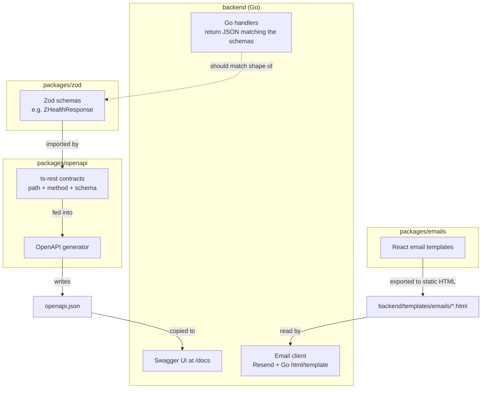

# Frontend/Packages — The Big Picture

Welcome! This doc is for someone who is **new to frontend tooling** (Node, TypeScript, monorepos) and just inherited this boilerplate. You don't need to read the code line-by-line — this explains **what exists, why it exists, and how it all fits together**.

> **Read order:** This file first (the big picture) → then `zod/README.md` → `openapi/README.md` → `emails/README.md`

---

## Part 1 — What kind of project is this?

This repo is a **monorepo**: one Git repository that contains *multiple, separately-versioned projects* living side by side.

```
go-boilerplate/
├── backend/          ← Go REST API (PostgreSQL, Redis, background jobs...)
├── packages/         ← TypeScript packages (this is what you're looking at)
│   ├── zod/          ← shared data shapes ("what does a User look like?")
│   ├── openapi/       ← generates API documentation from those shapes
│   └── emails/         ← email templates (HTML that gets sent to users)
├── package.json      ← root workspace config
└── turbo.json        ← build orchestration config
```

Why not just one big project? Because these three packages solve **different, independent problems**:

| Package | Problem it solves |
|---|---|
| `zod` | "What shape does our data have, and how do we validate it?" |
| `openapi` | "How do other developers (or tools) know what our API looks like?" |
| `emails` | "How do we design and preview the emails our app sends?" |

None of them run a website by themselves — they're **supporting packages**. They exist to be *consumed* by other things: the Go backend (for OpenAPI docs + email HTML), and eventually a frontend web app (for type-safe API calls).

---

## Part 2 — The tools you'll see everywhere

You don't need to master these, just recognize their names and know their one job:

| Tool | One-line job |
|---|---|
| **Bun** | A JavaScript/TypeScript runtime + package manager (like Node.js + npm, but faster). Command: `bun install`, `bun dev`. |
| **Turborepo** (`turbo`) | Runs the same script (e.g. `dev`, `build`) across *all* packages at once, and caches results so re-runs are fast. |
| **Workspaces** | A way to tell Bun "these folders are related packages that can depend on each other locally" (configured in the root `package.json`). |
| **TypeScript** | JavaScript with types. Catches bugs at compile time instead of runtime. |
| **Zod** | A library for describing data shapes ("schemas") that can validate data *and* produce TypeScript types from the same definition. |
| **ts-rest** | A library for describing API endpoints ("contracts") in a type-safe way, on top of Zod schemas. |
| **OpenAPI / Swagger** | An industry-standard JSON format for describing a REST API (endpoints, request/response shapes) so tools like Swagger UI can render interactive docs. |
| **React Email** | A library for building HTML emails using React components (instead of hand-writing fragile HTML tables). |

---

## Part 3 — How Bun workspaces work here

The root [package.json](../package.json) declares:

```json
"workspaces": ["apps/*", "packages/*"]
```

This tells Bun: "look inside `packages/` (and `apps/` if it exists) and treat every folder with its own `package.json` as an installable package."

Each package gets a name like `@boilerplate/zod` (see the `name` field in its `package.json`). Other packages can then depend on it like this:

```json
"dependencies": {
  "@boilerplate/zod": "workspace:*"
}
```

`workspace:*` is special — it means **"use the local folder on disk, don't download anything from npm."** This is how `openapi` can import types directly from `zod` without publishing it anywhere.

### Running commands across all packages

```bash
bun install      # installs dependencies for every package at once
bun dev          # asks Turborepo to run the "dev" script in every package
bun build        # asks Turborepo to run the "build" script in every package
```

Turborepo reads `turbo.json` to know **which order** to run things in. For example, `build` has `"dependsOn": ["^build"]`, meaning: "before building this package, build all the packages it depends on first." That's why `zod` (which nothing depends on being built first) finishes before `openapi` (which imports from `zod`).

---

## Part 4 — The end-to-end picture

Here's how the three packages relate to the Go backend and (eventually) a frontend app:



In plain words:

1. **`zod`** is the *single source of truth* for what a piece of data looks like (e.g., what fields a health-check response has).
2. **`openapi`** describes *API routes* (`GET /status`, etc.) using those Zod schemas, then **auto-generates** an OpenAPI JSON spec from them. That spec is copied straight into the Go backend (`backend/static/openapi.json`) so the backend's `/docs` page (Swagger UI) can render live, interactive API documentation.
3. **`emails`** is a separate concern — it's for designing and previewing the actual HTML emails using React. Once you're happy with a template, you "export" it to a static `.html` file that lands in `backend/templates/emails/`, where the Go backend's email-sending code (using Resend) fills in placeholders and sends it.

Notice: **none of this runs as a live server for users.** These packages are *build-time tools* — they generate files (`openapi.json`, `*.html`) that get consumed elsewhere. There is no `apps/web` frontend in this repo yet; these packages are the *foundation* that a future React/Next.js app would sit on top of (importing `@boilerplate/zod` and `@boilerplate/openapi/contracts` for type-safe API calls).

---

## Part 5 — Why keep schemas, docs, and emails in separate packages?

This is a deliberate architecture choice called **separation of concerns**:

- **`zod`** has almost zero dependencies (just `zod` itself) — it's meant to be imported by *anything* (a future web app, the openapi package, even scripts) without dragging in unrelated tooling.
- **`openapi`** depends on `zod` but adds heavier tooling (`ts-rest`, `@ts-rest/open-api`) that a simple data-consuming frontend wouldn't need.
- **`emails`** depends on React and `react-email` — completely unrelated to API contracts. Keeping it separate means a change to an email template never triggers a rebuild of your API types, and vice versa.

This mirrors the same idea you might already be seeing in the Go backend's `internal/` folders — each folder has one job.

---

## Part 6 — Quick Reference Cheat Sheet

| Term | Meaning |
|---|---|
| Monorepo | One repo, multiple independent packages |
| Workspace | A package folder registered so others can depend on it locally |
| `workspace:*` | "Use the local folder, not npm" dependency version |
| Turborepo | Orchestrates running scripts across packages, with caching |
| Zod schema | A description of a data shape that both validates data and generates a TS type |
| ts-rest contract | A type-safe description of an API route (path, method, request/response schema) |
| OpenAPI spec | A JSON document describing your whole API, consumed by tools like Swagger UI |
| React Email | Build emails as React components instead of raw HTML |

---

## Part 7 — Where to go next

- New to Zod? Read [`zod/README.md`](./zod/README.md)
- Want to understand how the API docs get generated? Read [`openapi/README.md`](./openapi/README.md)
- Curious about the email templates? Read [`emails/README.md`](./emails/README.md)
