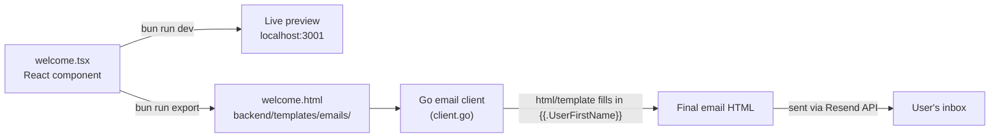

# `@boilerplate/emails` — Email Templates

> **Read this if:** you want to understand how the emails your app sends get designed, previewed, and handed off to the Go backend.

---

## Part 1 — What problem does this solve?

Transactional emails (welcome emails, password resets, receipts...) are notoriously painful to build:

- Email clients (Gmail, Outlook, Apple Mail...) render HTML very inconsistently — you basically have to write HTML like it's 2005 (tables, inline styles).
- There's no good way to "preview" what an email looks like without actually sending one.
- Designing directly in raw HTML is slow and error-prone.

This package solves that by letting you build emails as **React components** (which you probably already know how to write), and then compiling them down to the ugly-but-necessary raw HTML that actually gets sent — with a live preview server so you can see changes instantly.

---

## Part 2 — What is React Email (in plain English)?

[React Email](https://react.email) is a library of React components (`<Text>`, `<Button>`, `<Section>`, ...) that **look like normal React/JSX**, but under the hood, each one knows how to render itself into HTML that works reliably across email clients.

You write:

```tsx
<Text className="text-gray-700 text-base">Hi {userFirstName},</Text>
```

...and React Email turns this into safe, table-based, inline-styled HTML — the stuff email clients actually need — without you having to write it by hand.

It also ships a **local dev server** (`email dev`) that renders your templates in a browser preview, live-reloading as you edit, so you can design emails the same way you'd design any other React UI.

---

## Part 3 — What's actually in this package?

```
packages/emails/
├── package.json
└── src/
    └── templates/
        └── welcome.tsx   ← the "Welcome to Boilerplate" email
```

Right now there's a single template: `welcome.tsx`. It's a React component (`WelcomeEmail`) that takes a `userFirstName` prop and renders a welcome message with a call-to-action button. Notice the default value:

```tsx
userFirstName = "{{.UserFirstName}}"
```

That funny-looking `{{.UserFirstName}}` is **not** a React thing — it's a **Go template placeholder**. This is the bridge between the two worlds:

1. During **development**, this template renders in the browser using React (with a normal string like `"John"` for preview).
2. When **exported**, React Email bakes the template down to static HTML — but the `{{.UserFirstName}}` placeholder is left untouched in the output (because it's just treated as plain text by React Email).
3. The **Go backend** then treats that exported `.html` file as a [Go `html/template`](https://pkg.go.dev/html/template) — and does its own separate substitution, replacing `{{.UserFirstName}}` with the real user's name at send time (see [backend/internal/lib/email/client.go](../../../backend/internal/lib/email/client.go)).

So: **React is only used at design/build time.** By the time an email is actually sent to a real user, React is completely out of the picture — it's the Go backend filling in a plain HTML template string.

---

## Part 4 — The two commands that matter

```json
"scripts": {
  "dev": "email dev --dir ./src/templates -p 3001",
  "export": "email export --pretty --dir ./src/templates --outDir ../../backend/templates/emails"
}
```

- **`bun run dev`** — starts a local preview server at `http://localhost:3001`. Open it in a browser to see every template in `src/templates/` rendered live, with hot-reload as you edit. This is purely for *you*, the developer — nothing here gets sent to real users.
- **`bun run export`** — the important one. It compiles every `.tsx` template into a static `.html` file and writes it directly into `backend/templates/emails/`. This is the step that actually **hands the design off to the Go backend**. You must re-run this any time you change a template — the Go backend doesn't know about React/TSX, it only reads the exported `.html` files.

---

## Part 5 — How it fits into the bigger picture



---

## Part 6 — Running this package

```bash
cd packages/emails
bun install
bun run dev      # preview templates at http://localhost:3001
bun run export   # bake templates into backend/templates/emails/*.html
```

There's no `build` script here (unlike `zod` or `openapi`) — this package doesn't produce a library other code imports. Its only "output" is the exported static HTML files, produced on demand by `export`.

---

## Part 7 — Cheat sheet

| Term | Meaning |
|---|---|
| React Email | React component library for building HTML emails |
| `email dev` | CLI command that starts the live preview server |
| `email export` | CLI command that compiles templates to static `.html` |
| `PreviewProps` | Default props used only in the preview server, not in production |
| Go `html/template` placeholder (`{{.Field}}`) | Text the Go backend fills in at send time — untouched by React Email |
| Resend | The third-party service the Go backend uses to actually deliver the email |

---

## Part 8 — Try it yourself

1. Run `bun run dev` inside `packages/emails`, open `http://localhost:3001`, and click on `welcome`. Try editing some text in `welcome.tsx` and watch the preview update.
2. Add a new placeholder, e.g. a company name:
   ```tsx
   <Text>From the {"{{.CompanyName}}"} team</Text>
   ```
3. Run `bun run export`, then check `backend/templates/emails/welcome.html` — you'll see your new placeholder sitting there as plain text, waiting for the Go backend to fill it in.
4. To actually use it, the Go code sending this email needs to pass `"CompanyName"` into its template `data` map (see how `SendWelcomeEmail` in [backend/internal/lib/email/emails.go](../../../backend/internal/lib/email/emails.go) builds its `data` map).
