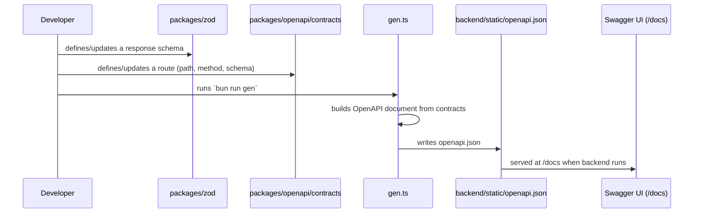

# `@boilerplate/openapi` — API Contracts & Generated Docs

> **Read this if:** you want to understand `ts-rest`, "contracts", and how `backend/static/openapi.json` gets created.

---

## Part 1 — What problem does this solve?

Once you have data shapes (from the `zod` package), you still need to describe **the actual API routes**:

- What's the URL path? (`/status`)
- What HTTP method? (`GET`, `POST`, ...)
- What does a successful response look like? (tie it to a Zod schema)
- Does this route need authentication?

And then, separately, you want other people (or tools like Swagger UI, or future frontend developers) to see **human-readable, interactive documentation** of your whole API.

This package does both:
1. Defines **contracts** — typed descriptions of each route — using a library called **ts-rest**.
2. **Generates** an industry-standard OpenAPI JSON file from those contracts, which gets copied into the Go backend so it can serve interactive docs at `/docs`.

---

## Part 2 — What is `ts-rest` (in plain English)?

[ts-rest](https://ts-rest.com) lets you describe an API endpoint as a plain TypeScript object — a **contract** — instead of scattering that information across route files, Postman collections, and manually-written docs.

Conceptually, a contract says:

> "There's a route called `getHealth`. It's a `GET` request to `/status`. If it succeeds (status 200), the response matches the `ZHealthResponse` Zod schema."

Because this is just TypeScript + Zod, you get:
- **Autocomplete** everywhere you reference the contract.
- **A single source of truth** for "what does this endpoint accept/return" that can be reused to generate OpenAPI docs, type-safe API clients, mock servers, etc.

**Note:** in this boilerplate, contracts are currently used **only to generate documentation** (the OpenAPI JSON). A frontend app *could* also use the same contract with a `ts-rest` client to make fully type-safe HTTP calls (`client.Health.getHealth()`) — that's the intended long-term use, even though no such frontend app exists yet in this repo.

---

## Part 3 — What's actually in this package?

```
packages/openapi/
├── package.json
├── openapi.json          ← the generated output (checked in for reference)
└── src/
    ├── contracts/
    │   ├── health.ts      ← the contract for the health-check route
    │   └── index.ts       ← combines all contracts into one "apiContract"
    ├── utils.ts            ← helper for describing auth requirements
    ├── index.ts            ← builds the final OpenAPI document object
    └── gen.ts              ← script that writes the OpenAPI JSON to disk
```

### Contracts (`contracts/`)

Each file under `contracts/` describes **one group of related routes** (here, just health checks). `contracts/index.ts` merges every group into one big `apiContract` — think of it as an index/table of contents for the whole API. As the API grows, you'd add a new file per resource (`contracts/users.ts`, `contracts/orders.ts`, ...) and register it in `contracts/index.ts`.

### `utils.ts` — describing security

Some routes need authentication, some don't. `getSecurityMetadata()` is a small helper that attaches "this route needs a Bearer token" (or a service token) metadata to a contract, which later gets turned into the correct OpenAPI "security requirement" so Swagger UI shows a padlock icon and lets you test authenticated requests.

### `index.ts` — assembling the OpenAPI document

This file takes the `apiContract` (all your routes) and calls `generateOpenApi(...)` (from `@ts-rest/open-api`) to turn it into a real OpenAPI 3.0 document — the same JSON format tools like Swagger UI or Postman understand. It also adds top-level info (API title, version, server URL) and declares the two supported authentication schemes (Bearer JWT, and a service-to-service token header).

### `gen.ts` — the actual generation script

This is the file you *run*. It takes the OpenAPI document built in `index.ts`, does one small cleanup step (converts a custom "file upload" placeholder type into the standard OpenAPI binary-file format), and then **writes the result to two places**:

1. `packages/openapi/openapi.json` — kept in this package for reference/versioning.
2. `backend/static/openapi.json` — the copy the **Go backend actually serves**. The backend's `/docs` route (see [backend/internal/handler/openapi.go](../../../backend/internal/handler/openapi.go)) renders Swagger UI pointing at this file.

---

## Part 4 — How it fits into the bigger picture



In short: **you edit TypeScript, run one command, and the Go backend's documentation page updates.** No hand-written OpenAPI YAML/JSON.

---

## Part 5 — Running this package

```bash
cd packages/openapi
bun install
bun run gen     # generates openapi.json (both copies) — run this after changing a contract
bun run build   # compiles TypeScript → dist/ (so other packages can import ./contracts)
bun run dev     # waits for zod's build, then compiles + watches for changes
```

After running `bun run gen`, restart (or just refresh) the Go backend and visit `http://localhost:8080/docs` to see the updated API docs.

---

## Part 6 — Cheat sheet

| Term | Meaning |
|---|---|
| Contract | A typed description of one API route (path, method, request/response schema) |
| `ts-rest` | Library for defining contracts and (optionally) type-safe clients from them |
| `@ts-rest/open-api` | Converts ts-rest contracts into a real OpenAPI JSON document |
| OpenAPI spec | Industry-standard JSON/YAML format describing a whole REST API |
| Swagger UI | An interactive web page that renders an OpenAPI spec so you can browse/try endpoints |
| Security scheme | How a route says "this needs a Bearer token" etc., shown as a padlock in Swagger UI |

---

## Part 7 — Try it yourself

To document a new endpoint:

1. Add its response shape to `packages/zod` (see that package's README).
2. Create (or edit) a file in `packages/openapi/src/contracts/`, e.g.:
   ```ts
   export const userContract = c.router({
     getUser: {
       method: "GET",
       path: "/users/:id",
       responses: { 200: ZUser },
       ...getSecurityMetadata(), // if it needs auth
     },
   });
   ```
3. Register it in `contracts/index.ts`.
4. Run `bun run gen` — the new route now appears in `backend/static/openapi.json` and Swagger UI.
