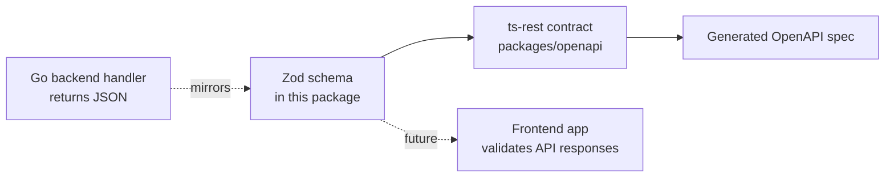

# `@boilerplate/zod` — Shared Data Shapes

> **Read this if:** you want to know what Zod is, why this package exists, and how a "schema" becomes a TypeScript type.

---

## Part 1 — What problem does this solve?

Every API has **data shapes**. A health-check response might look like:

```json
{
  "status": "healthy",
  "timestamp": "2026-09-24T10:00:00Z",
  "environment": "local",
  "checks": {
    "database": { "status": "healthy", "response_time": "1.2ms" }
  }
}
```

Somewhere, this shape needs to be **written down** so that:
1. TypeScript knows the type of this object (so your editor autocompletes `.status`, catches typos, etc.)
2. Code that *receives* this data at runtime can **validate** it actually looks like this (data from a network request is just `unknown` until proven otherwise).

Normally you'd write this twice — once as a TypeScript `interface`, and once as some validation logic. That's error-prone; they can drift apart. **Zod solves this by letting you write the shape once, and deriving both the type and the validator from it.**

---

## Part 2 — What is Zod (in plain English)?

[Zod](https://zod.dev) is a TypeScript library for describing data shapes as **schemas** — JavaScript objects that know how to:

- **Validate** — "does this piece of data actually match the shape I expect?"
- **Infer types** — TypeScript can look at a Zod schema and automatically produce the matching `type`, with zero duplication.

A schema looks like this (conceptually — not copy-pasted from the repo):

```ts
const ZUser = z.object({
  id: z.string(),
  age: z.number(),
});
```

From this one definition, you get:
- A TypeScript type: `type User = { id: string; age: number }`
- A runtime check: `ZUser.parse(someData)` throws if `someData` doesn't match.

This is the core idea behind **every file in this package**: define a schema once, use it everywhere.

---

## Part 3 — What's actually in this package?

```
packages/zod/
├── package.json      ← declares this as @boilerplate/zod
├── tsconfig.json      ← TypeScript compiler settings
└── src/
    ├── index.ts       ← the "barrel" file — re-exports everything
    ├── health.ts      ← the schema for the health-check API response
    └── utils.ts       ← reusable schema helpers (e.g. pagination)
```

- **`health.ts`** defines the shape of the `/status` health-check endpoint response (matches what the Go backend's health handler returns — see [backend/internal/handler/health.go](../../../backend/internal/handler/health.go)).
- **`utils.ts`** contains a reusable **helper function**, not a fixed schema — `schemaWithPagination(itemSchema)` wraps any schema in the standard `{ data: [...], total, page, limit, totalPages }` envelope used for list endpoints. This avoids re-writing pagination fields on every paginated resource.
- **`index.ts`** just re-exports everything from the other files, so consumers can write `import { ZHealthResponse } from "@boilerplate/zod"` instead of reaching into individual files.

One extra detail: `extendZodWithOpenApi(z)` is called once, at the top of `index.ts`. This "patches" Zod so that every schema also gains an `.openapi(...)` method, used later by the `openapi` package to attach documentation metadata (like descriptions and examples) to a schema. You don't need to understand this deeply — just know it's a one-time setup step that makes Zod and OpenAPI generation work together.

---

## Part 4 — Why is this its own package (and not just code inside the backend)?

Because **the backend is Go, and this needs to run in TypeScript.** The Go backend defines its own response shapes in Go structs (see `backend/internal/handler/`). This package is the **TypeScript-side mirror** of those shapes — written by hand to match, since Go and TypeScript can't share code directly.

> ⚠️ **Important mental model:** Zod schemas here don't *generate* the Go backend's behavior, and the Go backend doesn't *generate* these schemas automatically (in this boilerplate, at least). They're **kept in sync by convention** — if you add a field to a Go handler's response, you should update the matching Zod schema here too.

Keeping schemas in their own package (rather than inside `openapi` or a future frontend app) means:
- Any future frontend app can depend on `@boilerplate/zod` alone, without pulling in `ts-rest` or OpenAPI tooling it doesn't need.
- The `openapi` package can build contracts *on top of* these schemas without owning them.

---

## Part 5 — How it fits into the bigger picture



---

## Part 6 — Running this package

```bash
cd packages/zod
bun install     # install dependencies (only needed once, or after adding deps)
bun run build   # compiles TypeScript → dist/ (what other packages actually import)
bun run dev     # same as build, but watches for changes and recompiles automatically
```

Other packages (like `openapi`) import the **compiled output** in `dist/`, not the raw `src/` files — that's why `openapi`'s `dev` script does `wait-on ../zod/dist/index.js` first: it waits for `zod` to finish its first build before starting.

---

## Part 7 — Cheat sheet

| Term | Meaning |
|---|---|
| Schema | A Zod object describing a data shape |
| `z.object({...})` | Defines an object schema field-by-field |
| Type inference | Getting a TypeScript `type` automatically from a schema, no duplication |
| `.parse()` / `.safeParse()` | Runtime validation methods Zod schemas provide |
| Barrel file (`index.ts`) | A file that just re-exports things from other files, for cleaner imports |
| `extendZodWithOpenApi` | One-time setup that lets schemas carry OpenAPI metadata |

---

## Part 8 — Try it yourself

Add a new schema for a hypothetical `User` resource:

```ts
// packages/zod/src/user.ts
import { z } from "zod";

export const ZUser = z.object({
  id: z.string().uuid(),
  email: z.string().email(),
  createdAt: z.string().datetime(),
});
```

Then export it from `index.ts`:

```ts
export * from "./user.js";
```

Run `bun run build`, and any other package that depends on `@boilerplate/zod` can now `import { ZUser } from "@boilerplate/zod"` and get both the validator and the TypeScript type for free.
